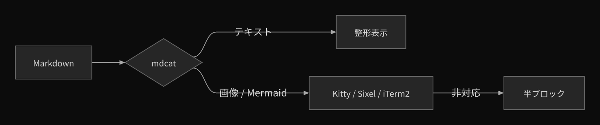

# mdview

`mdcat` の書式をそのままに、**画像と Mermaid を端末内に描画する** Markdown ビューアです。

Kitty graphics（WezTerm / kitty / Ghostty / Herdr）・Sixel（Windows Terminal 1.22+）・
iTerm2（iTerm2 / VSCode）のいずれかでフル解像度に描画し、
非対応の端末では ANSI トゥルーカラーの半ブロック（`▀`）で描画します。
Mermaid は [Pele](https://github.com/obsidianmd/pele) でレンダリングするため、
Chrome / Puppeteer は不要です。

[](https://github.com/oharato/mdview/actions/workflows/ci.yml)



## なぜ必要か

`mdcat` は kitty / iTerm2 / Terminology 系の画像プロトコルしか話せません。
Windows Terminal や SSH 越しの端末では画像も Mermaid も表示されず、
Mermaid はコードブロックのまま流れてしまいます。

`mdview` は

1. テキスト部分を `mdcat` に渡し（見た目は mdcat と同一）、
2. Mermaid を Pele で SVG → resvg で PNG 化し、
3. 画像・図を端末の実ピクセルに合わせて Sixel（または半ブロック）で描画します。

## 特徴

- **mdcat 互換のテキスト表示** — シンタックスハイライト、リンク、見出し記号などは mdcat のまま
- **Mermaid を内蔵レンダリング** — Pele（ゼロ DOM）+ resvg。1 図あたり 0.1〜0.2 秒、Chrome 不要
- **画像プロトコルを自前実装** — Kitty graphics / Sixel / iTerm2 を内蔵。
  外部の画像ビューア不要（`img2sixel` / `chafa` / `kitten icat` などは不要）
- **表示サイズを自動補正** — `CSI 16t` / `CSI 14t` で端末のセルサイズ・ウィンドウサイズを実測し、
  HiDPI（150% / 200% スケーリング）でも指定した桁数ぴったりに表示
- **自動フォールバック** — プロトコルが使えない端末では半ブロック描画（描画できない記法はコードブロック）
- **キャッシュ** — 図・画像は `~/.cache/mdview/` に保存され、2 回目以降は即表示
- **TypeScript / ESM** — Node.js LTS だけで動作。Python は不要

## 対応端末

| 端末 | 使用するプロトコル |
|---|---|
| WezTerm / kitty / Ghostty | Kitty graphics |
| Herdr（内側のペイン） | Kitty graphics（`kitty_graphics = true`、最近のバージョンは既定で有効） |
| Windows Terminal 1.22+ / xterm（Sixel 対応ビルド） | Sixel |
| iTerm2 | iTerm2 inline images |
| VSCode 1.80+ の統合ターミナル | iTerm2 inline images |
| その他 | ANSI 半ブロック（`▀`、低解像度） |

判定順は **Kitty graphics → Sixel → iTerm2 → 半ブロック** で、
`mdview --check` で実際の判定結果を確認できます。手動で固定する場合は
`-r kitty|sixel|iterm|blocks`、環境変数 `MDVIEW_KITTY=0|1` / `MDVIEW_SIXEL=0|1` を使います。

## 必要なもの

| 依存 | 用途 | 必須 |
|---|---|---|
| [Node.js](https://nodejs.org/) 22.12+（LTS） | 実行環境 | 必須 |
| [mdcat](https://github.com/swsnr/mdcat) | Markdown のテキスト描画 | 必須 |
| [pele](https://www.npmjs.com/package/pele) | Mermaid の SVG 化 | 同梱（依存関係） |
| [@resvg/resvg-js](https://www.npmjs.com/package/@resvg/resvg-js) | SVG → PNG | 同梱（依存関係） |
| [sharp](https://sharp.pixelplumbing.com/) | 画像のデコード・リサイズ | 同梱（依存関係） |
| pnpm 10+ | インストール / ビルド | 必須 |

## インストール

```bash
git clone https://github.com/oharato/mdview.git
cd mdview
./install.sh
```

`install.sh` は次を行います。

- Node.js / pnpm の確認（pnpm は corepack で有効化を試みます）
- `mdcat` が無ければ GitHub Releases から `~/.local/bin` に取得
- `pnpm install` → `pnpm build`（TypeScript → `dist/`）
- `~/.local/bin/mdview` から `dist/cli.js` へシンボリックリンク

インストール先を変えたい場合は `BIN_DIR=~/bin ./install.sh` のように指定してください。

### pnpm のグローバルインストール

```bash
pnpm add -g github:oharato/mdview   # prepare でビルドされます
```

## 使い方

```bash
mdview README.md                      # 表示
cat README.md | mdview                # 標準入力
mdview -w 100 -i 100 doc.md           # テキスト100桁 / 画像100桁
mdview -r blocks doc.md               # Sixel を使わず半ブロックで描画
mdview --check                        # 端末の対応状況を表示
mdview --refresh doc.md               # 端末判定をやり直す
```

### オプション

| オプション | 説明 |
|---|---|
| `-w, --width N` | テキストの最大桁数（既定: 端末幅、最大 120） |
| `-i, --image-width N` | 画像・図の横幅（端末桁数、既定: 端末幅いっぱい） |
| `-r, --renderer auto\|kitty\|sixel\|iterm\|blocks` | 描画方式（既定: 端末を自動判定） |
| `--image-colours N` | Sixel の色数（既定: 256） |
| `--image-bg auto\|none\|#RRGGBB` | 透過画像の背景（既定: 端末に合わせる） |
| `--pixel-scale F` | セルサイズを取得できない端末での倍率（HiDPI なら 2） |
| `--upscale / --no-upscale` | 小さい画像を端末幅まで拡大（既定: 有効・最大 3 倍） |
| `--light` | 明るい背景の端末として扱う（Mermaid のテーマ・画像背景） |
| `--mermaid-theme auto\|default\|dark\|neutral` | Mermaid の配色 |
| `--mermaid-width N` | Mermaid のラスタライズ幅 px（既定: 2048） |
| `-c, --no-colour` | 色・画像を無効化（生の Markdown に近い表示） |
| `--check` | 端末・依存の対応状況を表示して終了 |

環境変数: `MDVIEW_KITTY=0|1` / `MDVIEW_SIXEL=0|1`（プロトコルの強制）、
`MDVIEW_CELL=18x36`（セルサイズ上書き）、`MDVIEW_CACHE`（キャッシュ先）、
`MDVIEW_MDCAT`（mdcat のパス）。

## 動作のしくみ

1. **端末プローブ** — DA1（`ESC [ c`）で Sixel 対応を、Kitty のクエリ
   （`ESC _ G i=31 ; a=q,t=d,f=24 ; AAAA ESC \`）で Kitty graphics 対応を、
   `CSI 16 t` / `CSI 14 t` でセルサイズ・ウィンドウサイズ（実ピクセル）を 1 回の問い合わせで取得。
   Sixel の判定結果は `~/.cache/mdview/caps.json` に保存。
2. **Markdown の分解** — ```` ```mermaid ```` フェンスと `` をプレースホルダに置換し、
   テキスト部分だけ `mdcat --ansi` に渡す。
3. **Mermaid** — Pele が出力する SVG は CSS 変数で配色されるため、変数を実色へ解決してから
   resvg でラスタライズ（resvg は `var()` 非対応）。ダイアグラムは内容のハッシュでキャッシュ。
4. **画像の送出** — Kitty graphics は PNG を 4096 文字ずつ分割送出し、`C=1`（カーソル固定）で
   貼る。WezTerm は `C=1` だと「カーソルより下に残っている行数」までしか画像を貼らないため、
   先に空行を確保してから貼り、最後にカーソルを進める。Sixel はメディアンカット減色 +
   6 ピクセルバンド + `!<n><char>` のランレングス圧縮。iTerm2 は `ESC ]1337;File=inline=1`。
5. **半ブロック描画** — Sixel 非対応端末では `▀` と 24bit カラーで描画（`--colours 256` で 256 色）。

### トラブルシュート

```bash
mdview --check        # 端末・依存・採用プロトコルを表示
mdview --refresh .    # 端末判定をやり直す（キャッシュを無視）
mdview -r blocks .    # 画像プロトコルを使わず半ブロックで描画
```

`--check` の見方:

| 行 | 意味 |
|---|---|
| `terminal` | XTVERSION で識別した端末名（例: `wezterm` / `windows terminal`） |
| `kitty support` | 端末が kitty graphics のクエリに応答したか（`no response` は無応答） |
| `kitty transfer` | 実際に（複数チャンクの）画像データを送って応答があったか |
| `kitty usable` | 上記を踏まえて kitty を採用できるか |
| `sixel support` | DA1 の Sixel 属性 |
| `renderer` | 実際に採用されたプロトコル |

**`kitty support: yes` なのに `kitty transfer: 失敗` の場合**

端末は kitty graphics を話すが、画像データが届いていません。
Windows の WezTerm から通常の `ssh`（`ssh.exe` → ConPTY 経由）で接続している場合、
この経路では画像プロトコルが壊れることが知られています
（[wezterm#8070](https://github.com/wezterm/wezterm/issues/8070)）。
WezTerm 内蔵の SSH クライアントに切り替えると ConPTY を迂回でき、フル解像度で表示されます。

```powershell
wezterm ssh oharato@192.168.242.100
```

この場合 mdview は自動で半ブロック描画にフォールバックし、警告を 1 行表示します。
OSC 1337（iTerm2 方式）が通るかは `mdview -r iterm <file>` で試せます。

**WezTerm の Sixel 誤広告について**

WezTerm は DA1（`ESC [ c`）で「Sixel 対応」（属性 `4`）を返しますが、実際には
Sixel を実装していません。mdview は XTVERSION（`CSI > 0 q`）で WezTerm を識別し、
Sixel を使わないようにしています（使うと「真っ黒な空間」になるため）。

**画像が粗い（半ブロックになっている）場合**

`kitty support` / `sixel support` が `no` です。`-r kitty` などで強制するか、
多重化ツールのパススルー設定を確認してください。

### 開発

```bash
pnpm install
pnpm test        # vitest（Sixel エンコーダ / Markdown 分解 / テーマ解決）
pnpm typecheck
pnpm build
```

## 制限

- Sixel は **Windows Terminal 1.22 以降**で利用できます。
- tmux / screen 経由では、パススルー設定（`set -g allow-passthrough on` など）が無い限り
  画像プロトコルは通りません。その場合は半ブロック描画になります。
- Herdr は Kitty graphics を解釈して外側の端末へ転送します。`terminal.kitty_graphics = false`
  にしている場合は半ブロックになります。外側の接続経路（ConPTY など）が画像を壊す場合は
  Herdr 経由でも表示されません。
- `less` などのページャと併用すると画像は出ません（mdcat 単体と同じ制約）。
- 半ブロック描画は 1 セル 2 ピクセル相当のため、文字を含む複雑な図は粗くなります。
  Sixel 対応端末での利用を推奨します。
- Mermaid の対応範囲は Pele に準じます（Mermaid 12.1 相当）。描画できない記法は
  コードブロックとしてそのまま表示されます。

## ライセンス

MIT
