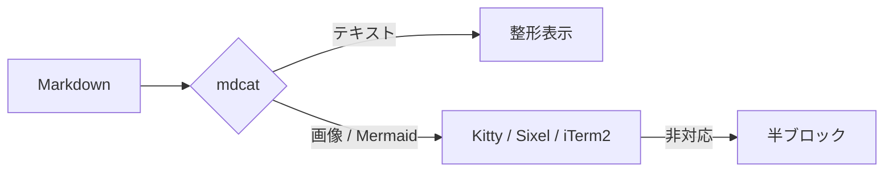
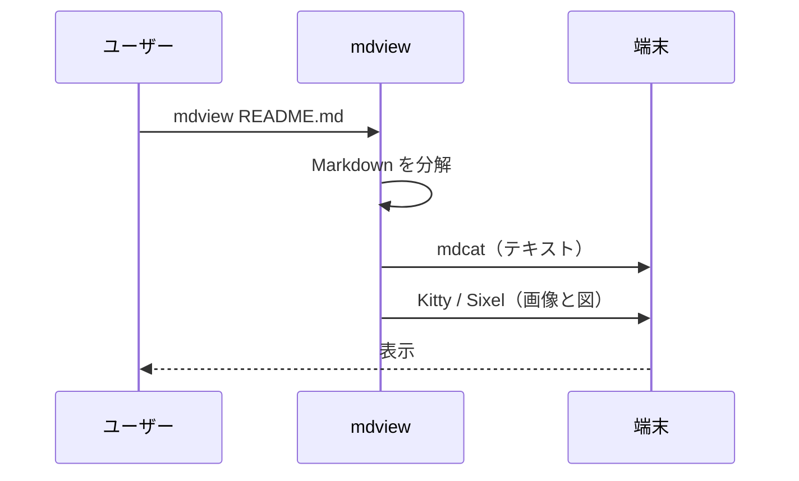
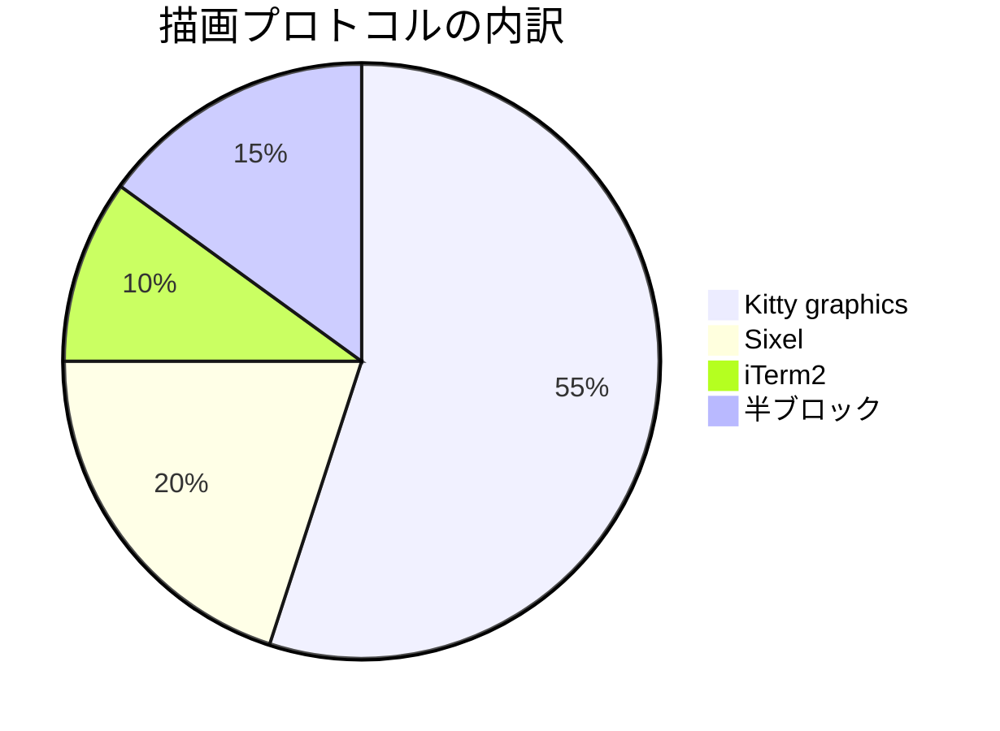
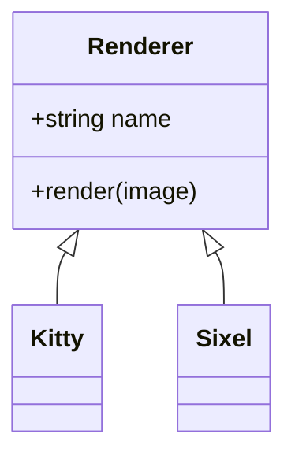
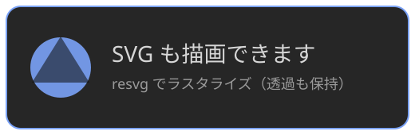

# mdview デモ

`mdcat` の書式をそのままに、**画像**と **Mermaid** を端末内に描画します。
テキスト部分は mdcat が担当するので、見た目はいつもの mdcat と同じです。

## テキスト表現

- **太字**、*斜体*、~~打ち消し線~~、`インラインコード`
- リンク: [oharato/mdview](https://github.com/oharato/mdview)
- 入れ子のリスト
  - レベル 2 の項目
    1. さらに深い番号付き
    2. もうひとつ

1. 手順その一
2. 手順その二
   - 補足はこのようにぶら下げる

> 引用はこのように表示されます。
> 複数行にまたがっても大丈夫です。

---

### 表

| プロトコル | 使える端末 | 解像度 |
|---|---|---|
| Kitty graphics | WezTerm / kitty / Ghostty / Herdr | フル |
| Sixel | Windows Terminal 1.22+ / xterm | フル |
| iTerm2 | iTerm2 / VSCode | フル |
| 半ブロック | その他の端末 | 低 |

## Mermaid

### フローチャート



### シーケンス図



### 円グラフ



### クラス図



## 画像

PNG（スクリーンショットや写真など）:


SVG（ベクター画像）:



## コード

```typescript
export function hello(name: string): string {
  return `こんにちは, ${name}!`;
}
```

```bash
mdview --check
mdview --update
```

```json
{ "renderer": "kitty", "imageWidth": 109, "light": false }
```

## 日本語と絵文字

全角と半角が混在していても表示幅は正しく計算されます。
絵文字もそのまま: 🎨 📐 🖼️
